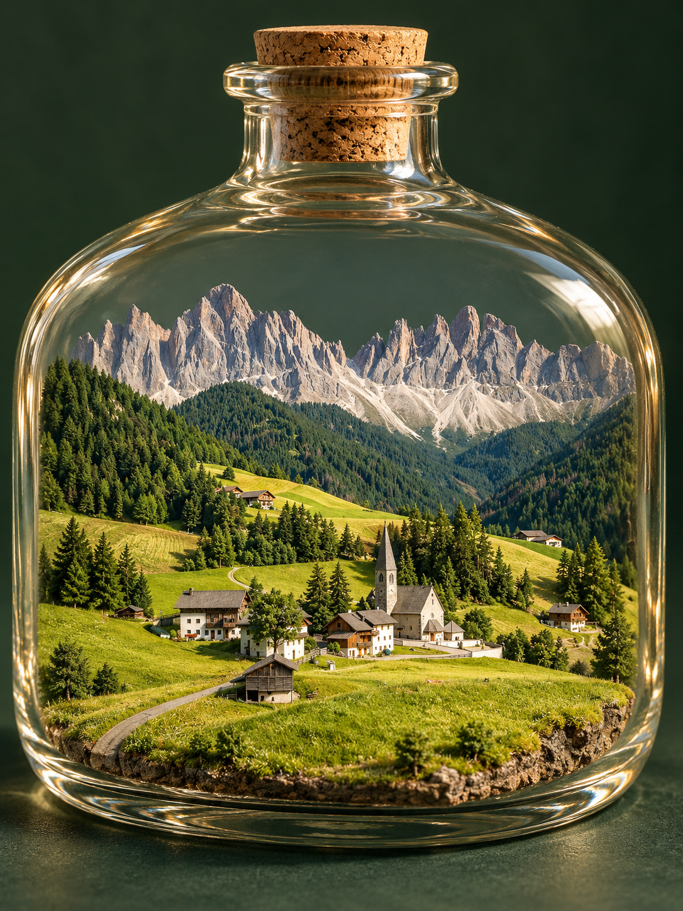

# 旅景收藏 · Travel Diorama

**把风景做成纪念品的 Skill。**

上传旅行或风景照片，把那一刻重构成玻璃瓶、行李箱或展示缸里的立体微缩景观。保留原图主要景物和空间关系，让颜色更鲜活；原照片里有人物时，可转成卡通手办。



## 安装

将这个仓库地址交给支持从 GitHub 安装 Skill 的 AI 助手：

```text
安装技能 qinzeiwang/travel-diorama
```

这是给助手的自然语言指令，不是终端命令。也可以下载本仓库，将文件夹命名为 `travel-diorama`，放入所用助手的技能目录。入口为 [SKILL.md](SKILL.md)。

## 使用

先上传原照片，然后输入：

```text
$travel-diorama
把照片做成玻璃瓶里的微缩景观，保留景物关系，颜色更鲜活。
```

还可以说：“把同一张照片换成打开的行李箱”“做成展示缸”“保留照片中的人物并做成卡通手办”。

默认输出一张 3:4 竖幅玻璃瓶景观，不额外添加文字。支持的容器和数量以你的要求为准。

## 需要什么

- 能读图、支持参考图生成或编辑的 AI 助手。
- 每次提供本次原照片，生成时必须把原图传给图像工具。
- 本仓库提供技能说明与可选辅助脚本，不包含图像模型或 API 服务。图片效果取决于实际使用的生成工具，可能需要修正。

## 文件

| 文件夹 | 内容 |
| --- | --- |
| `SKILL.md` | 简洁技能入口 |
| `references/` | 容器、识图、材质和验收规则 |
| `prompts/` | 识图、生图和复核提示词 |
| `templates/` | 可选记录模板 |
| `scripts/` | 批量追溯辅助脚本，仅使用 Python 标准库 |
| `tests/` | 辅助代码测试，不替代图片视觉验收 |

日常使用不需要填 JSON 或运行脚本。需要批量记录时使用 Python 3.10+：

```bash
python scripts/diorama.py --help
python -m unittest discover -s tests -v
```

## 示例与许可

示例为 AI 生成的微缩景观，内容依据为 [Pexels 上的多洛米蒂村落照片](https://www.pexels.com/photo/scenic-view-of-alpine-village-with-dolomites-32563289/)。原照片未打包，相关权利归原权利人。示例不保证精确地理还原。

技能文档与代码采用 [MIT License](LICENSE)；第三方照片及其相关权利不在该授权范围内。使用自己的照片时，请确保拥有相应使用权限。
